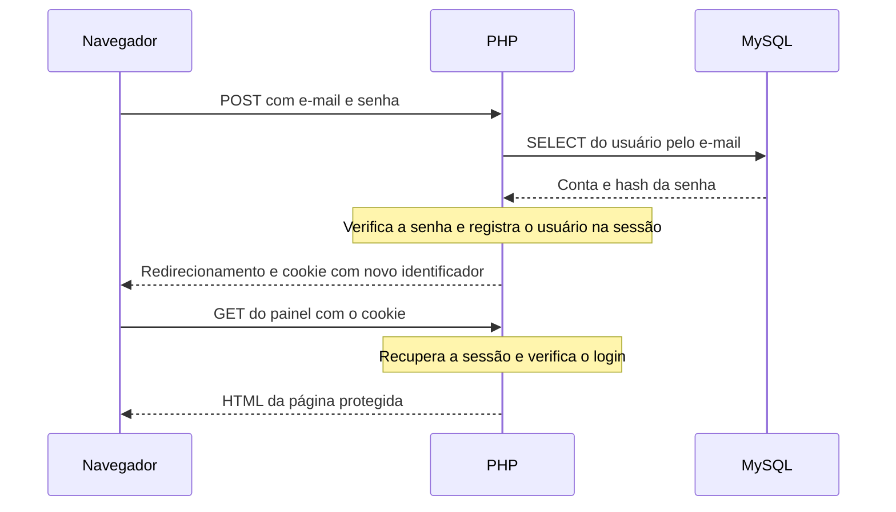

# PHP: sessões e autenticação

Depois de enviar um formulário de login, o usuário precisa continuar identificado ao abrir outras páginas. Os dados de sessão permitem manter essa informação entre requisições.

Esta apostila apresenta o uso de `$_SESSION`, a verificação de e-mail e senha e a proteção de páginas com PHP puro. O exemplo dá continuidade ao [CRUD de produtos](../06-crud-php/exemplos/tutorial-crud-produtos-minimalista/). Os fundamentos de formulários, PDO e redirecionamentos estão nas apostilas de [PHP](../05-php/) e [CRUD](../06-crud-php/).

## Índice

1. [Por que guardar dados entre requisições?](#1-por-que-guardar-dados-entre-requisições)
2. [Sessão, cookie e banco de dados](#2-sessão-cookie-e-banco-de-dados)
3. [Iniciar, gravar, ler e remover dados](#3-iniciar-gravar-ler-e-remover-dados)
4. [Cadastro e autenticação](#4-cadastro-e-autenticação)
5. [Senhas com hash](#5-senhas-com-hash)
6. [O fluxo do login](#6-o-fluxo-do-login)
7. [Proteger páginas e actions](#7-proteger-páginas-e-actions)
8. [Encerrar a sessão](#8-encerrar-a-sessão)
9. [Construção prática: login no CRUD de produtos](#9-construção-prática-login-no-crud-de-produtos)
10. [Quadro de consulta rápida](#10-quadro-de-consulta-rápida)

## 1. Por que guardar dados entre requisições?

Considere este percurso:

1. O usuário envia seu e-mail e sua senha.
2. O PHP consulta o banco e verifica os dados.
3. O navegador abre a listagem de produtos.

A listagem é uma **nova requisição**. Uma variável comum, como `$usuario`, criada no processamento do login não fica automaticamente disponível nessa outra execução do PHP.

Uma **sessão** permite associar dados a uma sequência de requisições do mesmo navegador. Podemos usá-la para guardar a identificação do usuário autenticado, uma preferência de apresentação ou uma mensagem que aparece na próxima página.

## 2. Sessão, cookie e banco de dados

No funcionamento padrão das sessões PHP:

- os dados da sessão ficam no servidor;
- o navegador guarda um cookie com um **identificador de sessão**;
- nas próximas requisições, o navegador envia esse cookie;
- o PHP usa o identificador para recuperar os dados correspondentes.

Um **cookie** é uma pequena informação armazenada pelo navegador e enviada ao servidor nas requisições correspondentes. O cookie de sessão do PHP costuma se chamar `PHPSESSID`. Ele identifica a sessão; não contém automaticamente o nome, a senha ou todos os dados de `$_SESSION`.

Podemos comparar esse identificador a um número de guarda-volumes: o número fica com a pessoa, enquanto o conteúdo permanece no local de armazenamento.

| Recurso | Onde fica | Para que serve neste exemplo |
|---|---|---|
| Variável comum, como `$nome` | Memória da execução PHP | Processar a requisição atual |
| `$_POST` | PHP, durante a requisição | Ler os campos enviados no login |
| `$_SESSION` | Dados mantidos pelo servidor entre requisições | Guardar quem está autenticado |
| Cookie de sessão | Navegador | Enviar o identificador da sessão ao servidor |
| MySQL | Servidor de banco de dados | Manter usuários e produtos cadastrados |

Na configuração padrão, o PHP armazena os dados da sessão em arquivos no servidor. Usar `$_SESSION` não exige criar uma tabela de sessões nem gravar esses dados com PDO. O banco continua responsável pelos cadastros permanentes.

O identificador da sessão também não é o `id` do usuário: uma sessão pode existir antes do login, por exemplo, para guardar uma preferência.

## 3. Iniciar, gravar, ler e remover dados

### Iniciar ou retomar

```php
session_start();
```

`session_start()` inicia uma sessão ou retoma uma existente, usando o identificador recebido do navegador. Depois dessa chamada, os dados ficam acessíveis pelo array associativo `$_SESSION`.

**Coloque a chamada antes de qualquer HTML, `echo` ou saída de texto.** A sessão pode precisar enviar um cookie nos cabeçalhos HTTP. Cada arquivo que usa a sessão precisa iniciá-la, diretamente ou por um arquivo incluído.

### Gravar dados

Crie `gravar_sessao.php`:

```php
<?php
session_start();

$_SESSION['tema'] = 'escuro';
$_SESSION['visitas'] = 0;

echo '<a href="ler_sessao.php">Ler os dados da sessão</a>';
```

A atribuição usa a mesma sintaxe de um array associativo. O PHP mantém os valores para as próximas requisições dessa sessão.

### Ler e alterar em outra página

Crie `ler_sessao.php` na mesma pasta:

```php
<?php
session_start();

$_SESSION['visitas'] = ($_SESSION['visitas'] ?? 0) + 1;

echo 'Tema: ' . ($_SESSION['tema'] ?? 'não escolhido') . '<br>';
echo 'Visitas: ' . $_SESSION['visitas'];
```

O operador `??` fornece um valor quando a chave ainda não existe ou contém `null`. Assim, a contagem começa em zero mesmo se essa for a primeira página aberta.

Na pasta desses dois arquivos, execute `php -S localhost:8000`. Abra [gravar_sessao.php](http://localhost:8000/gravar_sessao.php), siga o link e recarregue a página de leitura. A contagem aumenta. Se abrir a página de gravação novamente, ela define a contagem como zero outra vez.

Abas do mesmo perfil do navegador normalmente compartilham os cookies e, portanto, a sessão. Uma janela anônima permite experimentar um contexto separado, sem os dados da janela comum.

### Remover uma informação

Em um arquivo que já iniciou a sessão:

```php
unset($_SESSION['tema']);
```

`unset()` remove somente essa chave. As outras informações da sessão, como a contagem de visitas, continuam disponíveis.

Para verificar a existência de um dado, use:

```php
if (isset($_SESSION['usuario_id'])) {
    echo 'Existe um usuário identificado nesta sessão.';
}
```

`isset()` retorna verdadeiro quando a chave existe e seu valor não é `null`.

## 4. Cadastro e autenticação

| Operação | O que faz |
|---|---|
| Cadastro | Grava os dados de uma conta no banco |
| Autenticação ou login | Confere as credenciais e identifica o usuário |
| Sessão autenticada | Mantém essa identificação nas próximas requisições |
| Logout ou sair | Encerra essa identificação |

Cadastrar uma conta não autentica o usuário automaticamente. Da mesma forma, iniciar uma sessão com `session_start()` não comprova que a pessoa informou uma senha correta.

Neste exemplo, o PHP guarda o `id` e o nome na sessão **somente depois de verificar a senha**. Não basta receber um `id` em um formulário e copiá-lo para `$_SESSION`.

**Autorização** é outra decisão: define o que o usuário pode fazer. Aqui, qualquer usuário cadastrado pode usar o CRUD após o login; a proteção verifica se há um usuário autenticado.

## 5. Senhas com hash

O banco guarda um **hash da senha**, produzido por uma função apropriada para senhas. Não guarda a senha original em texto legível.

No cadastro:

```php
$hash = password_hash($_POST['senha'], PASSWORD_DEFAULT);
```

`password_hash()` produz o hash. `PASSWORD_DEFAULT` escolhe o algoritmo padrão oferecido pelo PHP, sem exigir que o aluno configure seus detalhes. A coluna usada para guardar o resultado é `VARCHAR(255)`.

No login:

```php
if (password_verify($_POST['senha'], $usuario['senha'])) {
    echo 'Senha correta.';
}
```

`password_verify()` compara a senha informada com o hash armazenado e retorna `true` ou `false`. O nome da coluna é `senha`, mas seu conteúdo é o hash.

Não se recupera a senha original a partir do hash. Também não se compara um novo resultado de `password_hash()` com o texto do banco: a função pode produzir hashes diferentes para a mesma senha. A verificação é feita com `password_verify()`.

O campo HTML `type="password"` apenas oculta os caracteres na tela. O hash é produzido pelo PHP no servidor. Para enviar credenciais pela internet, a conexão precisa usar HTTPS.

## 6. O fluxo do login

O formulário envia e-mail e senha por POST. O PHP busca a conta pelo e-mail e verifica a senha com o hash encontrado.

Quando a verificação tem sucesso, o trecho central do login é:

```php
session_regenerate_id(true);

$_SESSION['usuario_id'] = $usuario['id'];
$_SESSION['usuario_nome'] = $usuario['nome'];

header('Location: painel.php');
exit;
```

Esse trecho pressupõe que `session_start()` já foi chamado e que `$usuario` contém a conta cuja senha foi verificada. `session_regenerate_id(true)` troca o identificador da sessão após o login e remove os dados associados ao identificador anterior. O usuário autenticado passa a usar o novo identificador.

Na sessão, guardamos os dados necessários para identificar a conta. A senha e seu hash não precisam ser copiados para `$_SESSION`.



Se a conta não existe ou a senha está incorreta, o login do exemplo responde com status **401** e a mensagem `E-mail ou senha incorretos.`.

O [guia prático](exemplos/README.md) apresenta o formulário e a action completos.

## 7. Proteger páginas e actions

Crie um arquivo reutilizável chamado `verificar_login.php`:

```php
<?php
session_start();

if (!isset($_SESSION['usuario_id'])) {
    header('Location: login_form.php');
    exit;
}
```

O arquivo retoma a sessão. Se não há usuário identificado, ele redireciona para o login e encerra a execução. O `exit` impede que o restante da página ou da action seja executado.

No início de cada arquivo protegido, inclua:

```php
<?php
require 'verificar_login.php';
```

Nesse caso, o arquivo de verificação já chama `session_start()`; a página não repete essa chamada.

Depois da verificação, é possível consultar o usuário da sessão:

```php
<p>Olá, <?= $_SESSION['usuario_nome'] ?>.</p>
```

**A proteção precisa existir no servidor, inclusive nas actions.** Esconder um botão no HTML não impede que alguém acesse o endereço diretamente. No CRUD de produtos, a verificação fica antes da conexão e do SQL nas actions de cadastro, edição e exclusão, além das páginas de consulta e dos formulários.

## 8. Encerrar a sessão

O botão de saída pode enviar um formulário para `logout.php`:

```html
<form method="post" action="logout.php">
    <button>Sair</button>
</form>
```

O arquivo `logout.php` contém:

```php
<?php
session_start();

$_SESSION = [];
session_destroy();

header('Location: login_form.php');
exit;
```

`$_SESSION = []` limpa os dados acessíveis no array, e `session_destroy()` remove os dados da sessão no servidor. Ao tentar abrir uma página protegida novamente, a verificação não encontra `usuario_id` e solicita o login.

`session_destroy()` não apaga automaticamente o cookie do navegador. O encerramento do acesso acima ocorre porque a identificação do usuário foi removida da sessão.

Fechar uma aba não equivale a clicar em Sair. A duração da sessão depende das configurações do servidor e do navegador; o logout encerra explicitamente o acesso autenticado.

## 9. Construção prática: login no CRUD de produtos

[Abrir o guia de construção e testes](exemplos/README.md).

O guia acrescenta uma tabela de usuários e oito arquivos ao projeto do [tutorial de CRUD de produtos](../06-crud-php/exemplos/tutorial-crud-produtos-minimalista/). O aluno cria os arquivos a partir dos códigos apresentados no texto.

| Parte | Responsabilidade |
|---|---|
| Cadastro da conta | Gravar nome, e-mail e hash da senha |
| Login | Consultar o usuário, verificar a senha e iniciar a identificação |
| Verificação compartilhada | Restringir páginas e actions a usuários autenticados |
| Painel | Mostrar o nome do usuário e o acesso ao CRUD |
| Logout | Limpar a sessão e voltar ao formulário de login |

O banco continua sendo `crud_armazem`. A tabela `produtos` permanece responsável pelos produtos; a nova tabela `usuarios` guarda as contas. Sair do sistema não apaga o cadastro nem os produtos do banco.

## 10. Quadro de consulta rápida

| Preciso… | Uso… |
|---|---|
| Iniciar ou retomar uma sessão | `session_start()` antes da saída |
| Guardar uma informação | `$_SESSION['chave'] = $valor;` |
| Ler um valor com alternativa | `$_SESSION['chave'] ?? 'alternativa'` |
| Verificar se uma chave existe e não é nula | `isset($_SESSION['chave'])` |
| Remover uma informação | `unset($_SESSION['chave']);` |
| Produzir o hash da senha | `password_hash($senha, PASSWORD_DEFAULT)` |
| Verificar a senha informada | `password_verify($senha, $hash)` |
| Trocar o identificador após o login | `session_regenerate_id(true)` |
| Restringir uma página | `require 'verificar_login.php';` |
| Encerrar a identificação | Limpar `$_SESSION` e chamar `session_destroy()` |

### O que você precisa guardar

- A variável comum pertence à execução atual; a sessão mantém dados entre requisições.
- Os dados de sessão ficam no servidor; o cookie transporta o identificador.
- Cadastro, autenticação e autorização têm responsabilidades diferentes.
- O banco guarda o hash da senha; o login usa `password_verify()`.
- A sessão identifica o usuário depois da verificação das credenciais.
- Toda página ou action restrita verifica o login antes de executar sua operação.
- O logout encerra o acesso, sem apagar os dados permanentes do banco.

## Referências

- [PHP — Uso básico de sessões](https://www.php.net/manual/pt_BR/session.examples.basic.php)
- [PHP — session_start](https://www.php.net/manual/pt_BR/function.session-start.php)
- [PHP — session_regenerate_id](https://www.php.net/manual/pt_BR/function.session-regenerate-id.php)
- [PHP — session_destroy](https://www.php.net/manual/pt_BR/function.session-destroy.php)
- [PHP — password_hash](https://www.php.net/manual/pt_BR/function.password-hash.php)
- [PHP — password_verify](https://www.php.net/manual/pt_BR/function.password-verify.php)
