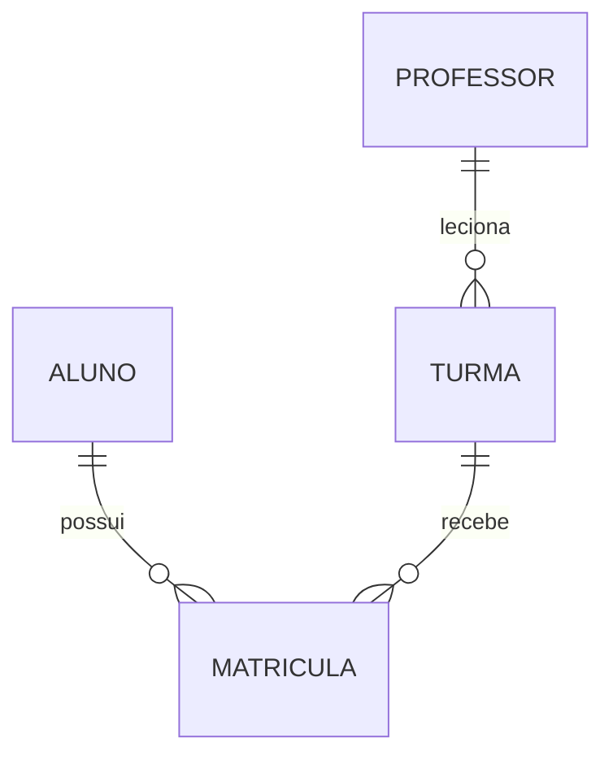

# PHP: relacionamento N–N com alunos, turmas e matrículas

Ana pode cursar **Web 1** e **Banco de Dados** ao mesmo tempo. A turma de **Web 1**, por sua vez, pode receber Ana, Bruno e outros alunos. Chamamos essa associação de **matrícula**: cada matrícula liga um aluno a uma turma.

Nesta aula, você vai usar PHP puro, PDO e MySQL para entender três maneiras de matricular alunos e uma maneira de desmatriculá-los. O [projeto completo](exemplos/README.md) aplica os conceitos de [sessão e autenticação da aula 08](../08-sessoes-autenticacao/) e os padrões de formulário, consulta e gravação da [aula de CRUD](../06-crud-php/).

## Índice

1. [Dois relacionamentos no mesmo sistema](#1-dois-relacionamentos-no-mesmo-sistema)
2. [Como o banco guarda uma matrícula](#2-como-o-banco-guarda-uma-matrícula)
3. [Três formas de matricular](#3-três-formas-de-matricular)
4. [Como listar os alunos de uma turma](#4-como-listar-os-alunos-de-uma-turma)
5. [Como desmatricular um aluno](#5-como-desmatricular-um-aluno)
6. [Executar o projeto completo](#6-executar-o-projeto-completo)

## 1. Dois relacionamentos no mesmo sistema

| Relacionamento | Como funciona | Onde fica a ligação |
|---|---|---|
| Professor e turma: **1–N** | Um professor pode lecionar em várias turmas. Cada turma tem um professor. | `turmas.professor_id` |
| Aluno e turma: **N–N** | Um aluno pode estar em várias turmas. Uma turma pode ter vários alunos. | Uma linha em `matriculas` para cada par de IDs |



O relacionamento N–N aparece no banco como dois relacionamentos 1–N: um aluno pode ter várias matrículas e uma turma pode receber várias matrículas. Cada matrícula pertence a exatamente um aluno e a exatamente uma turma.

O **usuário** que faz login e o **aluno** matriculado têm papéis diferentes. Uma conta em `usuarios` dá acesso ao sistema. Um registro em `alunos` representa uma pessoa que pode ser matriculada.

## 2. Como o banco guarda uma matrícula

Veja três linhas da tabela intermediária:

| `aluno_id` | `turma_id` | Significado |
|---|---|---|
| 1 | 1 | Ana está em Web 1 |
| 1 | 2 | Ana está em Banco de Dados |
| 2 | 1 | Bruno está em Web 1 |

As **chaves estrangeiras** apontam para alunos e turmas que já existem. A **chave primária composta** é o par `(aluno_id, turma_id)`: cada ID pode aparecer várias vezes, mas o mesmo par só pode aparecer uma vez.

Matricular Ana em Web 1 significa inserir o par `(1, 1)` em `matriculas`. Os cadastros do aluno e da turma já existem. O esquema completo está em [config/banco.sql](exemplos/config/banco.sql).

## 3. Três formas de matricular

| Tela | O que o usuário faz | Como o formulário envia os IDs |
|---|---|---|
| Matrícula por IDs | Digita os números do aluno e da turma | Dois campos `type="number"` |
| Matrícula por listas | Escolhe o aluno e a turma pelo nome | Dois `select`; cada opção envia o ID do registro |
| Detalhes da turma | Escolhe um aluno e clica em **Matricular** | Um `select` para o aluno e um campo oculto com o ID da turma aberta |

Nos três casos, o formulário envia `aluno_id` e `turma_id` por POST para [matricula/criar_action.php](exemplos/php/matricula/criar_action.php). O PHP verifica o login e usa os valores para inserir a matrícula com PDO. O trecho central é:

```php
$turmaId = (int) $_POST['turma_id'];
$comando = $pdo->prepare(
    'INSERT INTO matriculas (aluno_id, turma_id) VALUES (?, ?)
     ON DUPLICATE KEY UPDATE aluno_id = aluno_id'
);
$comando->execute([$_POST['aluno_id'], $turmaId]);
```

O trecho `ON DUPLICATE KEY UPDATE` deixa a linha como está se o par já existe. Assim, repetir a matrícula não cria outra linha. A chave estrangeira continua impedindo IDs que não existem.

## 4. Como listar os alunos de uma turma

A consulta parte de `matriculas`, filtra pela turma aberta e usa `JOIN` para buscar os dados dos alunos:

```sql
SELECT a.id, a.nome
FROM matriculas AS m
JOIN alunos AS a ON a.id = m.aluno_id
WHERE m.turma_id = ?
ORDER BY a.nome, a.id;
```

`m` e `a` são apelidos para as tabelas. O `ON` liga cada matrícula ao seu aluno. O `WHERE` escolhe apenas as matrículas da turma aberta. O PHP fornece o ID no lugar do `?` com `execute([$turmaId])` e percorre o resultado para montar a lista.

## 5. Como desmatricular um aluno

Ao lado de cada aluno, o botão **Desmatricular** envia os dois IDs por POST. A ação remove o par correspondente:

```sql
DELETE FROM matriculas WHERE aluno_id = ? AND turma_id = ?;
```

O aluno e a turma continuam cadastrados. Se Ana está em duas turmas, desmatriculá-la de uma mantém a matrícula na outra. Usar só o ID do aluno no `WHERE` removeria todas as matrículas dele.

## 6. Executar o projeto completo

Siga o [guia de execução](exemplos/README.md) para criar e popular o banco e abrir a home. O sistema inclui login, logout e cadastros de professores, turmas, alunos e usuários. Os arquivos PHP ficam separados por entidade e usam o mesmo cabeçalho com menu e o mesmo rodapé.

Para conferir a relação N–N, use **Ana** em duas turmas e **Bruno** em uma das turmas de Ana. Depois, desmatricule Ana de uma turma e confira que o vínculo na outra permanece.

### Consulta rápida

| O que quero fazer | O que muda no banco |
|---|---|
| Atribuir um professor a uma turma | Gravo o ID em `turmas.professor_id` |
| Matricular um aluno | Insiro o par em `matriculas` |
| Listar os alunos de uma turma | Consulto `matriculas` com `JOIN alunos` |
| Desmatricular um aluno | Excluo somente o par em `matriculas` |

### Referências

- [MySQL — chaves estrangeiras](https://dev.mysql.com/doc/refman/8.4/en/create-table-foreign-keys.html)
- [MySQL — JOIN](https://dev.mysql.com/doc/refman/8.4/en/join.html)
- [MySQL — ON DUPLICATE KEY UPDATE](https://dev.mysql.com/doc/refman/8.4/en/insert-on-duplicate.html)
- [PHP — PDO::prepare](https://www.php.net/manual/pt_BR/pdo.prepare.php)
