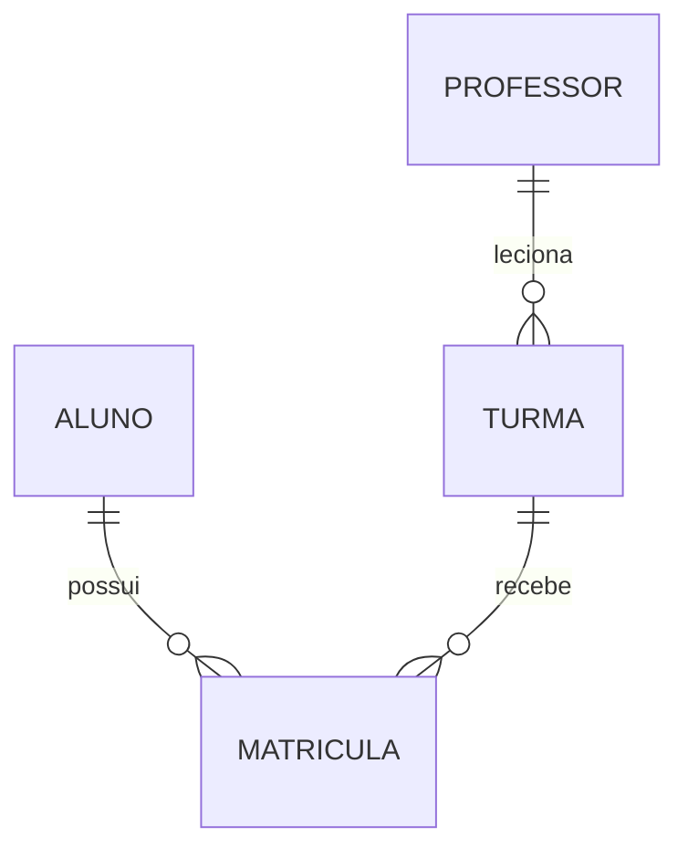

# PHP: relacionamento N–N com alunos, turmas e matrículas

Ana pode cursar **Web 1** e **Banco de Dados** ao mesmo tempo. A turma de **Web 1**, por sua vez, pode receber Ana, Bruno e outros alunos. Chamamos essa associação de **matrícula**: cada matrícula liga um aluno a uma turma.

Nesta aula, você vai aprender a reconhecer um relacionamento N–N, guardar os vínculos em uma tabela e consultar esses dados nos dois sentidos. O [projeto completo](exemplos/README.md) mostra como fazer isso com PHP puro, PDO e MySQL, reaproveitando os conceitos de [sessão e autenticação](../08-sessoes-autenticacao/) e de [CRUD](../06-crud-php/).

## Índice

1. [Dois relacionamentos no mesmo sistema](#1-dois-relacionamentos-no-mesmo-sistema)
2. [Como o banco guarda uma matrícula](#2-como-o-banco-guarda-uma-matrícula)
3. [Três formas de matricular](#3-três-formas-de-matricular)
4. [Como consultar o vínculo nos dois sentidos](#4-como-consultar-o-vínculo-nos-dois-sentidos)
5. [Como desmatricular um aluno](#5-como-desmatricular-um-aluno)
6. [Executar o projeto completo](#6-executar-o-projeto-completo)

## 1. Dois relacionamentos no mesmo sistema

Para identificar o tipo de relacionamento, faça a pergunta nos **dois sentidos**. Para cada aluno, quantas turmas ele pode frequentar? Para cada turma, quantos alunos ela pode receber? Como pode haver vários vínculos nos dois sentidos, o relacionamento é **N–N**, também chamado de **muitos para muitos**.

| Relacionamento | Como funciona | Onde fica a ligação |
|---|---|---|
| Professor e turma: **1–N** | Um professor pode lecionar em várias turmas. Cada turma tem um professor. | `turmas.professor_id` |
| Aluno e turma: **N–N** | Um aluno pode estar em várias turmas. Uma turma pode ter vários alunos. | Uma linha em `matriculas` para cada par de IDs |

O **N** indica que vários vínculos são possíveis. Um aluno recém-cadastrado pode estar em nenhuma turma, e uma turma nova pode não ter alunos.

### Por que criar uma terceira tabela?

No relacionamento professor–turma, uma única coluna em `turmas` basta, porque cada turma tem só um professor. Se fizéssemos o mesmo para alunos, uma coluna `turma_id` em `alunos` guardaria apenas uma turma por aluno. No sentido inverso, uma coluna `aluno_id` em `turmas` guardaria apenas um aluno por turma.

A solução é guardar os vínculos em uma **tabela intermediária**. Em `matriculas`, cada linha liga dois registros que já existem: um aluno e uma turma. Para colocar o mesmo aluno em outra turma, acrescentamos outra linha com o mesmo `aluno_id` e um `turma_id` diferente.



Leia o diagrama assim: `||` indica **exatamente um** e `o{` indica **zero ou muitos**. A tabela intermediária transforma a associação N–N em dois vínculos 1–N: **aluno → matrículas** e **turma → matrículas**.

O **usuário** que faz login e o **aluno** matriculado têm papéis diferentes. Uma conta em `usuarios` dá acesso ao sistema. Um registro em `alunos` representa uma pessoa que pode ser matriculada.

## 2. Como o banco guarda uma matrícula

Nos dados iniciais do projeto, Ana tem ID `1` e Bruno tem ID `2`. Na tabela de turmas, Web 1 tem ID `1` e Banco de Dados tem ID `2`. Veja como três matrículas ligam esses registros:

| `aluno_id` | `turma_id` | Significado |
|---|---|---|
| 1 | 1 | Ana está em Web 1 |
| 1 | 2 | Ana está em Banco de Dados |
| 2 | 1 | Bruno está em Web 1 |

Leia a tabela pelo `aluno_id = 1`: as duas primeiras linhas mostram as turmas de Ana. Agora leia pelo `turma_id = 1`: a primeira e a terceira linhas mostram os alunos de Web 1. **Os mesmos dados respondem às duas perguntas.**

### O que cada chave garante

Trecho de [config/banco.sql](exemplos/config/banco.sql):

```sql
PRIMARY KEY (aluno_id, turma_id),
FOREIGN KEY (aluno_id) REFERENCES alunos(id) ON DELETE CASCADE,
FOREIGN KEY (turma_id) REFERENCES turmas(id) ON DELETE CASCADE
```

- As **chaves estrangeiras** garantem que os IDs apontam para um aluno e uma turma existentes.
- A **chave primária composta** identifica a matrícula pelo **par inteiro**. Os pares `(1, 1)`, `(1, 2)` e `(2, 1)` podem coexistir. O segundo `(1, 1)` seria uma duplicata. Neste exemplo, não é preciso criar um ID separado para a matrícula.
- O `ON DELETE CASCADE` remove as matrículas de um aluno ou de uma turma quando o respectivo cadastro é excluído. Excluir uma turma, por exemplo, remove os vínculos dessa turma e preserva os alunos.

## 3. Três formas de matricular

| Tela | O que o usuário faz | Como o formulário envia os IDs |
|---|---|---|
| [Matrícula por IDs](exemplos/php/matricula/criar_ids_form.php) | Digita os números do aluno e da turma | Dois campos `type="number"` |
| [Matrícula por listas](exemplos/php/matricula/criar_selects_form.php) | Escolhe o aluno e a turma pelo nome | Dois `select`; cada opção envia o ID do registro |
| [Detalhes da turma](exemplos/php/turma/detalhes.php) | Escolhe um aluno e clica em **Matricular** | Um `select` para o aluno e um campo oculto com o ID da turma aberta |

Em um `select`, o navegador mostra o rótulo da opção, por exemplo, **Ana Souza**. Ao enviar o formulário, ele manda o `value` da opção selecionada: o ID `1`. Na tela de detalhes, o ID da turma já é conhecido porque a turma está aberta. O campo oculto envia esse valor junto com a escolha do aluno.

Assim, nos três casos chegam os mesmos campos por POST: `aluno_id` e `turma_id`. Os três formulários usam [matricula/criar_action.php](exemplos/php/matricula/criar_action.php). Para matricular Ana em Web 1, os valores são `aluno_id=1` e `turma_id=1`. Depois de verificar o login, o PHP usa o PDO para gravar o vínculo:

```php
$turmaId = (int) $_POST['turma_id'];
$comando = $pdo->prepare(
    'INSERT INTO matriculas (aluno_id, turma_id) VALUES (?, ?)
     ON DUPLICATE KEY UPDATE aluno_id = aluno_id'
);
$comando->execute([$_POST['aluno_id'], $turmaId]);
```

O `INSERT` tenta acrescentar uma linha em `matriculas`. Se o par já existe, a atribuição `aluno_id = aluno_id` mantém o registro como está. As chaves estrangeiras continuam impedindo matrículas com IDs que não existem.

## 4. Como consultar o vínculo nos dois sentidos

### Da turma para os alunos

Na [tela de detalhes](exemplos/php/turma/detalhes.php), conhecemos o ID da turma. Partimos de `matriculas`, usamos `WHERE` para escolher os vínculos com essa turma e usamos `JOIN` para buscar os nomes dos alunos:

```sql
SELECT a.id, a.nome
FROM matriculas AS m
JOIN alunos AS a ON a.id = m.aluno_id
WHERE m.turma_id = ?
ORDER BY a.nome, a.id;
```

`m` e `a` são apelidos para as tabelas. O `ON` indica como encontrar o aluno de cada matrícula. O PHP passa o ID da turma no lugar do `?` com `execute([$id])`. Se a turma aberta é Web 1 (`id=1`), o resultado para as três linhas da seção 2 é **Ana Souza** e **Bruno Lima**.

### Do aluno para as turmas

Para responder à pergunta inversa, filtre por `aluno_id` e faça o `JOIN` com `turmas`. A consulta abaixo é um exemplo para testar no MySQL com o ID de Ana:

```sql
SELECT t.id, t.nome
FROM matriculas AS m
JOIN turmas AS t ON t.id = m.turma_id
WHERE m.aluno_id = 1
ORDER BY t.nome, t.id;
```

Nesse caso, o resultado é **Banco de Dados** e **Web 1**. A tabela intermediária é a mesma. O que muda é o ID que já conhecemos e a tabela onde buscamos os nomes.

## 5. Como desmatricular um aluno

Ao lado de cada aluno, o botão **Desmatricular** envia os dois IDs por POST. A ação remove o par correspondente:

```sql
DELETE FROM matriculas WHERE aluno_id = ? AND turma_id = ?;
```

Se o botão for o de Ana em Web 1, a [ação de desmatrícula](exemplos/php/matricula/deletar_action.php) exclui a linha `(1, 1)`. O par `(1, 2)` mantém Ana em Banco de Dados e o par `(2, 1)` mantém Bruno em Web 1. Os cadastros do aluno e da turma também continuam no banco. Por isso o `WHERE` usa os **dois IDs**.

## 6. Executar o projeto completo

Siga o [guia de execução](exemplos/README.md) para criar e popular o banco e abrir a home. O sistema inclui login, logout e cadastros de professores, turmas, alunos e usuários. Os arquivos PHP ficam separados por entidade e usam o mesmo cabeçalho com menu e o mesmo rodapé.

Para conferir na prática, abra os detalhes de **Web 1** e de **Banco de Dados** com o banco recém-populado. Observe em quais turmas Ana e Bruno aparecem. Desmatricule Ana apenas de Web 1 e confira a lista das duas turmas e o cadastro de alunos.

### Consulta rápida

| O que quero fazer | O que faço no banco |
|---|---|
| Atribuir um professor a uma turma | Gravo o ID em `turmas.professor_id` |
| Matricular um aluno | Insiro o par em `matriculas` |
| Listar os alunos de uma turma | Consulto `matriculas` com `JOIN alunos` |
| Listar as turmas de um aluno | Consulto `matriculas` com `JOIN turmas` |
| Desmatricular um aluno | Excluo somente o par em `matriculas` |

### Referências

- [MySQL — chaves estrangeiras](https://dev.mysql.com/doc/refman/8.4/en/create-table-foreign-keys.html)
- [MySQL — JOIN](https://dev.mysql.com/doc/refman/8.4/en/join.html)
- [MySQL — ON DUPLICATE KEY UPDATE](https://dev.mysql.com/doc/refman/8.4/en/insert-on-duplicate.html)
- [PHP — PDO::prepare](https://www.php.net/manual/pt_BR/pdo.prepare.php)
