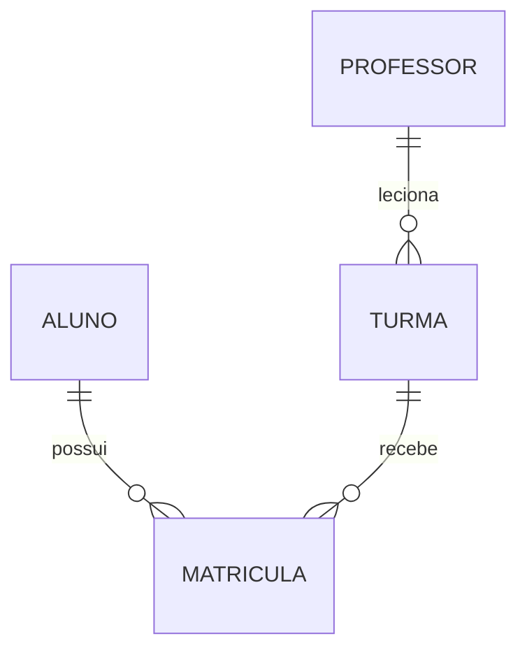

# PHP: relacionamento N–N com alunos, turmas e matrículas

Em um sistema escolar, os cadastros de alunos, professores e turmas estão relacionados. O sistema precisa registrar qual professor é responsável por cada turma e quais alunos estão matriculados nela. Essas associações orientam a organização das tabelas e a construção das telas da aplicação.

Esta apostila apresenta o relacionamento **N–N**, ou **muitos para muitos**, a partir da matrícula de alunos em turmas. O estudo acompanha a representação desse vínculo no banco, sua criação por formulários, as consultas nos dois sentidos e a desmatrícula. O [projeto completo](exemplos/README.md) implementa essas operações com PHP puro, PDO e MySQL, dando continuidade aos conteúdos de [CRUD](../06-crud-php/) e de [sessão e autenticação](../08-sessoes-autenticacao/).

## Índice

1. [Dois relacionamentos no mesmo sistema](#1-dois-relacionamentos-no-mesmo-sistema)
2. [Como o banco guarda uma matrícula](#2-como-o-banco-guarda-uma-matrícula)
3. [Três formas de matricular](#3-três-formas-de-matricular)
4. [Como consultar o vínculo nos dois sentidos](#4-como-consultar-o-vínculo-nos-dois-sentidos)
5. [Como desmatricular um aluno](#5-como-desmatricular-um-aluno)
6. [Executar o projeto completo](#6-executar-o-projeto-completo)

## 1. Dois relacionamentos no mesmo sistema

Para identificar o tipo de relacionamento, observe quantos registros podem se associar nos **dois sentidos**. No sistema desta aula, um professor pode lecionar em várias turmas, e cada turma tem um professor responsável. Esse é um relacionamento **1–N**, ou **um para muitos**.

A associação entre alunos e turmas funciona de outra forma. Ana, por exemplo, pode estar nas turmas de **Web 1** e **Banco de Dados** ao mesmo tempo. A turma de **Web 1** também pode receber Bruno e outros alunos. Como um aluno pode participar de várias turmas e uma turma pode receber vários alunos, esse relacionamento é **N–N**. Cada vínculo entre um aluno e uma turma é uma **matrícula**.

A comparação abaixo resume os dois casos:

| Relacionamento | Como funciona | Onde fica a ligação |
|---|---|---|
| Professor e turma: **1–N** | Um professor pode lecionar em várias turmas. Cada turma tem um professor. | `turmas.professor_id` |
| Aluno e turma: **N–N** | Um aluno pode estar em várias turmas. Uma turma pode ter vários alunos. | Uma linha em `matriculas` para cada par de IDs |

O **N** indica que vários vínculos são possíveis. Um aluno recém-cadastrado pode estar em nenhuma turma, e uma turma nova pode não ter alunos.

### Por que criar uma terceira tabela?

No relacionamento professor–turma, uma única coluna em `turmas` basta, porque cada turma tem só um professor. Se fizéssemos o mesmo para alunos, uma coluna `turma_id` em `alunos` guardaria apenas uma turma por aluno. No sentido inverso, uma coluna `aluno_id` em `turmas` guardaria apenas um aluno por turma.

A solução é guardar os vínculos em uma **tabela intermediária**. Em `matriculas`, cada linha liga dois registros que já existem: um aluno e uma turma. Para colocar o mesmo aluno em outra turma, acrescentamos outra linha com o mesmo `aluno_id` e um `turma_id` diferente.



Leia o diagrama assim: `||` indica **exatamente um** e `o{` indica **zero ou muitos**. A tabela intermediária transforma a associação N–N em dois vínculos 1–N: **aluno → matrículas** e **turma → matrículas**.

## 2. Como o banco guarda uma matrícula

Com a tabela intermediária, cada matrícula é armazenada como um par: o ID do aluno e o ID da turma. Nos dados iniciais do projeto, Ana tem ID `1` e Bruno tem ID `2`. Na tabela de turmas, Web 1 tem ID `1` e Banco de Dados tem ID `2`. Veja como três matrículas ligam esses registros:

| `aluno_id` | `turma_id` | Significado |
|---|---|---|
| 1 | 1 | Ana está em Web 1 |
| 1 | 2 | Ana está em Banco de Dados |
| 2 | 1 | Bruno está em Web 1 |

Leia a tabela pelo `aluno_id = 1`: as duas primeiras linhas mostram as turmas de Ana. Agora leia pelo `turma_id = 1`: a primeira e a terceira linhas mostram os alunos de Web 1. **Os mesmos dados respondem às duas perguntas.**

Além de guardar os IDs, é preciso definir como identificar cada matrícula e impedir vínculos repetidos. Duas opções comuns permitem representar essa regra.

### Opção 1: chave primária composta

O projeto usa as duas chaves estrangeiras como uma **única chave primária composta**. Trecho de [config/banco.sql](exemplos/config/banco.sql):

```sql
PRIMARY KEY (aluno_id, turma_id),
FOREIGN KEY (aluno_id) REFERENCES alunos(id) ON DELETE CASCADE,
FOREIGN KEY (turma_id) REFERENCES turmas(id) ON DELETE CASCADE
```

Cada coluna pode repetir seu valor em várias linhas, mas a **combinação das duas não pode se repetir**. Os pares `(1, 1)`, `(1, 2)` e `(2, 1)` são permitidos. Outro `(1, 1)` é uma duplicata.

No contexto deste sistema, isso significa que **um aluno não pode se matricular duas vezes na mesma turma**. A dupla de IDs já identifica a matrícula, sem um ID separado.

As **chaves estrangeiras** garantem que o aluno e a turma existem. O `ON DELETE CASCADE` remove as matrículas de um aluno ou de uma turma quando o respectivo cadastro é excluído. Excluir uma turma remove os vínculos dessa turma e preserva os alunos.

### Opção 2: ID próprio e restrição UNIQUE composta

Outra possibilidade é dar um **ID independente** a cada matrícula. A estrutura abaixo é uma alternativa à tabela do projeto; ela não deve ser executada sobre a tabela já criada:

```sql
CREATE TABLE matriculas (
    id INT AUTO_INCREMENT PRIMARY KEY,
    aluno_id INT NOT NULL,
    turma_id INT NOT NULL,
    UNIQUE (aluno_id, turma_id),
    FOREIGN KEY (aluno_id) REFERENCES alunos(id) ON DELETE CASCADE,
    FOREIGN KEY (turma_id) REFERENCES turmas(id) ON DELETE CASCADE
);
```

Aqui, `id` identifica o registro. Porém, IDs diferentes não impedem que duas linhas tenham o mesmo aluno e a mesma turma. Por isso, a restrição **`UNIQUE (aluno_id, turma_id)`** mantém a regra de uma matrícula por aluno em cada turma. Ela atua sobre as duas **colunas de chave estrangeira**.

| Estrutura | Como identifica uma matrícula | Como impede o mesmo aluno na mesma turma duas vezes |
|---|---|---|
| Chave primária composta | Pelo par `aluno_id, turma_id` | A própria chave primária impede a repetição |
| ID próprio | Pelo `id` da matrícula | A restrição `UNIQUE (aluno_id, turma_id)` impede a repetição |

### Quando repetir o par faz sentido: médico, consulta e paciente

Um médico atende vários pacientes, e um paciente pode consultar vários médicos. A tabela `consultas` registra esses atendimentos. **O mesmo paciente pode consultar o mesmo médico várias vezes**, em datas diferentes:

| `id` da consulta | `medico_id` | `paciente_id` | `data_hora` |
|---|---|---|---|
| 1 | 3 | 8 | 2026-03-10 09:00 |
| 2 | 3 | 8 | 2026-04-15 14:00 |

Uma chave primária composta **apenas por `(medico_id, paciente_id)`** rejeitaria a segunda consulta. Nesse contexto, um ID próprio permite identificar cada atendimento:

```sql
CREATE TABLE consultas (
    id INT AUTO_INCREMENT PRIMARY KEY,
    medico_id INT NOT NULL,
    paciente_id INT NOT NULL,
    data_hora DATETIME NOT NULL,
    FOREIGN KEY (medico_id) REFERENCES medicos(id),
    FOREIGN KEY (paciente_id) REFERENCES pacientes(id)
);
```

Esse trecho pressupõe as tabelas `medicos` e `pacientes` com uma coluna `id INT PRIMARY KEY`. Não há `UNIQUE (medico_id, paciente_id)`, pois ele também impediria novos atendimentos do mesmo par. Cada consulta representa uma ocorrência do relacionamento.

**A escolha da chave depende da regra do sistema:** em `matriculas`, o par aluno–turma é único; em `consultas`, o par médico–paciente pode se repetir. O projeto desta aula mantém a primeira opção, com chave primária composta em `matriculas`.

## 3. Três formas de matricular

Definida a estrutura no banco, o próximo passo é receber do usuário o aluno e a turma que deseja associar. O projeto apresenta três formas de fazer essa escolha. A interface muda, mas todas enviam os dois IDs necessários para criar a matrícula:

| Tela | O que o usuário faz | Como o formulário envia os IDs |
|---|---|---|
| [Matrícula por IDs](exemplos/php/matricula/criar_ids_form.php) | Digita os números do aluno e da turma | Dois campos `type="number"` |
| [Matrícula por listas](exemplos/php/matricula/criar_selects_form.php) | Escolhe o aluno e a turma pelo nome | Dois `select`; cada opção envia o ID do registro |
| [Detalhes da turma](exemplos/php/turma/detalhes.php) | Escolhe um aluno e clica em **Matricular** | Um `select` para o aluno e um campo oculto com o ID da turma aberta |

Em um `select`, o navegador mostra o rótulo da opção, por exemplo, **Ana Souza**. Ao enviar o formulário, ele manda o `value` da opção selecionada: o ID `1`. Na tela de detalhes, o ID da turma já é conhecido porque a turma está aberta. O campo oculto envia esse valor junto com a escolha do aluno.

Assim, nos três casos chegam os mesmos campos por POST: `aluno_id` e `turma_id`. Os três formulários usam [matricula/criar_action.php](exemplos/php/matricula/criar_action.php). Para matricular Ana em Web 1, os valores são `aluno_id=1` e `turma_id=1`. Depois de verificar o login, o PHP usa o PDO para gravar o vínculo:

```php
$turmaId = (int) $_POST['turma_id'];
$comando = $pdo->prepare(
    'INSERT INTO matriculas (aluno_id, turma_id) VALUES (?, ?)
     ON DUPLICATE KEY UPDATE aluno_id = aluno_id'
);
$comando->execute([$_POST['aluno_id'], $turmaId]);
```

O `INSERT` tenta acrescentar uma linha em `matriculas`. Se o par já existe, a atribuição `aluno_id = aluno_id` mantém o registro como está. As chaves estrangeiras continuam impedindo matrículas com IDs que não existem.

## 4. Como consultar o vínculo nos dois sentidos

Depois de gravar as matrículas, o sistema precisa mostrá-las nas telas. Como a tabela intermediária guarda os IDs, usamos consultas com `JOIN` para obter também os nomes. Podemos partir de uma turma para encontrar seus alunos ou de um aluno para encontrar suas turmas.

### Da turma para os alunos

Na [tela de detalhes](exemplos/php/turma/detalhes.php), conhecemos o ID da turma. Partimos de `matriculas`, usamos `WHERE` para escolher os vínculos com essa turma e usamos `JOIN` para buscar os nomes dos alunos:

```sql
SELECT a.id, a.nome
FROM matriculas AS m
JOIN alunos AS a ON a.id = m.aluno_id
WHERE m.turma_id = ?
ORDER BY a.nome, a.id;
```

`m` e `a` são apelidos para as tabelas. O `ON` indica como encontrar o aluno de cada matrícula. O PHP passa o ID da turma no lugar do `?` com `execute([$id])`. Se a turma aberta é Web 1 (`id=1`), o resultado para as três linhas da seção 2 é **Ana Souza** e **Bruno Lima**.

### Do aluno para as turmas

Para responder à pergunta inversa, filtre por `aluno_id` e faça o `JOIN` com `turmas`. A consulta abaixo é um exemplo para testar no MySQL com o ID de Ana:

```sql
SELECT t.id, t.nome
FROM matriculas AS m
JOIN turmas AS t ON t.id = m.turma_id
WHERE m.aluno_id = 1
ORDER BY t.nome, t.id;
```

Nesse caso, o resultado é **Banco de Dados** e **Web 1**. A tabela intermediária é a mesma. O que muda é o ID que já conhecemos e a tabela onde buscamos os nomes.

## 5. Como desmatricular um aluno

A lista de alunos matriculados também permite desfazer um vínculo. Na tela de detalhes da turma, o botão **Desmatricular**, ao lado de cada aluno, envia os dois IDs por POST. A ação remove o par correspondente:

```sql
DELETE FROM matriculas WHERE aluno_id = ? AND turma_id = ?;
```

Se o botão for o de Ana em Web 1, a [ação de desmatrícula](exemplos/php/matricula/deletar_action.php) exclui a linha `(1, 1)`. O par `(1, 2)` mantém Ana em Banco de Dados e o par `(2, 1)` mantém Bruno em Web 1. Os cadastros do aluno e da turma também continuam no banco. Por isso o `WHERE` usa os **dois IDs**.

## 6. Executar o projeto completo

O projeto completo reúne a estrutura do banco, os formulários de matrícula, as consultas e a desmatrícula apresentados nas seções anteriores. Ele inclui também login, logout e cadastros de professores, turmas, alunos e usuários. Os arquivos PHP ficam separados por entidade e usam o mesmo cabeçalho com menu e o mesmo rodapé.

O **usuário** que faz login e o **aluno** matriculado têm papéis diferentes. Uma conta em `usuarios` dá acesso ao sistema. Um registro em `alunos` representa uma pessoa que pode ser matriculada.

Siga o [guia de execução](exemplos/README.md) para criar e popular o banco e abrir a home. Crie uma conta pela opção **Criar conta** e entre para acessar os cadastros e as matrículas.

Para conferir na prática, abra os detalhes de **Web 1** e de **Banco de Dados** com o banco recém-populado. Observe em quais turmas Ana e Bruno aparecem. Desmatricule Ana apenas de Web 1 e confira a lista das duas turmas e o cadastro de alunos.

### Consulta rápida

| O que quero fazer | O que faço no banco |
|---|---|
| Atribuir um professor a uma turma | Gravo o ID em `turmas.professor_id` |
| Matricular um aluno | Insiro o par em `matriculas` |
| Listar os alunos de uma turma | Consulto `matriculas` com `JOIN alunos` |
| Listar as turmas de um aluno | Consulto `matriculas` com `JOIN turmas` |
| Desmatricular um aluno | Excluo somente o par em `matriculas` |

### Referências

- [MySQL — PRIMARY KEY e UNIQUE](https://dev.mysql.com/doc/refman/8.4/en/create-table.html)
- [MySQL — chaves estrangeiras](https://dev.mysql.com/doc/refman/8.4/en/create-table-foreign-keys.html)
- [MySQL — JOIN](https://dev.mysql.com/doc/refman/8.4/en/join.html)
- [MySQL — ON DUPLICATE KEY UPDATE](https://dev.mysql.com/doc/refman/8.4/en/insert-on-duplicate.html)
- [PHP — PDO::prepare](https://www.php.net/manual/pt_BR/pdo.prepare.php)
